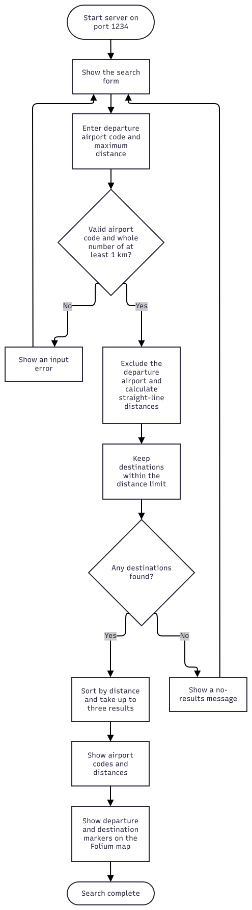

# Weekend Escape Finder

A simple Python web app that finds up to three destinations within a chosen distance from a departure airport.

## Run locally

```powershell
python -m pip install -r requirements.txt
python main.py
```

Open [http://localhost:1234](http://localhost:1234). Enter `BER` as the departure airport and `800` as the maximum distance, then select **Find destinations**.

## How it works

- `airportsdata` provides airport coordinates.
- `geopy` calculates straight-line distances.
- `folium` displays the departure airport and matching destinations on a map.

The map background requires an internet connection.

## Application flow


